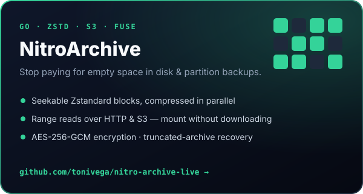
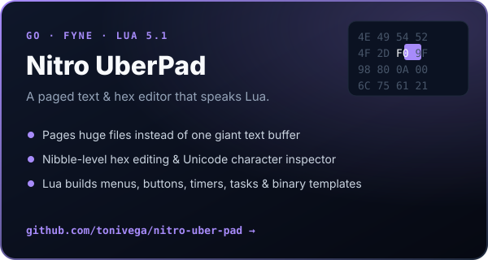
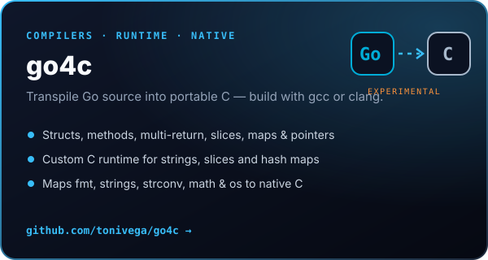

<div align='center'>



<p>
  <a href='https://www.nitrobutton.com'></a>
  <a href='mailto:toni@nitrobutton.com?subject=Project%20or%20consulting%20enquiry&body=Project%3A%0A%0ACurrent%20situation%3A%0A%0ABiggest%20blocker%3A%0A%0ADesired%20deadline%3A'></a>
  <a href='https://wa.me/34933900538?text=Hi%20Toni%2C%20I%27d%20like%20to%20discuss%20a%20software%20or%20DevOps%20project.'></a>
</p>

<p>
  
  
  
  
  
  
  
  
  
  
</p>

</div>


## ⚡ Featured open-source projects

<p align='center'>
  <a href='https://github.com/tonivega/nitro-archive-live'></a>
  <a href='https://github.com/tonivega/nitro-ondemand-tunneler'></a>
</p>
<p align='center'>
  <a href='https://github.com/tonivega/nitro-uber-pad'></a>
  <a href='https://github.com/tonivega/go4c'></a>
</p>

<details>
<summary><b>Why these projects are interesting</b></summary>
<br>

- **NitroArchive** — independently compressed Zstandard blocks, concurrent compression with ordered output, HTTP/S3 range reads, FUSE mounting of remote archives, AES-256-GCM encryption and recovery from truncated archives. Built to stop paying cloud storage for zero-filled disk images.
- **Nitro On-Demand Tunneler** — a dependency-free TCP gate that accepts connections immediately, wakes a container, script or SSH tunnel, waits for readiness and relays traffic. Shared startup per tunnel, explicit failure semantics, `ssh -G` integration, hot reload and six cross-compiled binaries.
- **Nitro UberPad** — a Fyne desktop editor that pages large files instead of loading one giant buffer, edits binary data nibble by nibble, inspects Unicode, and lets Lua scripts create menus, toolbar buttons, timers, background tasks and binary templates — all observable through an activity journal.
- **go4c** — an experimental Go → C transpiler with its own C runtime for strings, slices and hash maps, covering structs, methods, multiple returns, pointers and selected standard library mappings.

</details>

### 🧰 More engineering work

| Project | What it demonstrates |
| --- | --- |
| [**NitroProxy**](https://github.com/tonivega/nitroproxy) | Dependency-light Go reverse proxy with Docker discovery, Traefik-compatible routing, automatic TLS, live container events and round-robin backends. |
| [**Simple Worker**](https://github.com/tonivega/simple-worker) | Lightweight distributed job queue with HTTP coordination, concurrent Go workers, authentication, timeouts and container builds. |
| [**NitroPilot**](https://github.com/tonivega/nitropilot) | Autonomous AI agent that plans, executes, validates and corrects development and DevOps operations. |
| [**FUSE HTML**](https://github.com/tonivega/tonivega-fuse-html) | FUSE filesystem exposing websites and their linked resources as browsable directory trees. |
| [**Portable Chromium Screenshot**](https://github.com/tonivega/tonivega-chromium-screenshot) | Self-contained webpage renderer with embedded Chromium and pipeline-friendly output. |


## 🎯 Problems I solve

Companies usually contact me when:

- 🐢 deployments are slow, manual or unreliable;
- 💸 cloud infrastructure has become expensive or difficult to maintain;
- 🛟 a platform needs to be stabilized, rescued or modernized;
- 🤖 an internal process should be automated;
- 🚀 a new SaaS product, API or technical platform needs to be built;
- 🏭 industrial, IoT or legacy systems need to talk to modern services;
- 🧭 the team needs senior technical direction without another full-time hire.

I work across application development **and** infrastructure, so I can follow a project from architecture and implementation through deployment, monitoring and ongoing operation.

## 🛠️ Consulting and project services

<table>
<tr>
<td valign='top' width='33%'>

**☁️ DevOps &amp; cloud**

- Cloud and container architecture
- Docker-based platforms
- CI/CD implementation
- Deployment automation
- Reverse proxies, networking, TLS
- Monitoring and reliability
- Audits and technical rescue

</td>
<td valign='top' width='33%'>

**🧱 Platforms &amp; backends**

- SaaS and internal business tools
- APIs and integrations
- Distributed workers and queues
- Data collection pipelines
- Marketplaces and workflows
- Legacy modernization

</td>
<td valign='top' width='33%'>

**🛰️ AI, IoT &amp; industrial**

- AI agents and automation
- IoT device management
- Edge and industrial integration
- Privacy-conscious sensors
- AS/400 maintenance and integration
- Custom technical prototypes

</td>
</tr>
</table>

## 🌐 Platforms and product experience

Through [Nitrobutton](https://www.nitrobutton.com) I have worked on platforms involving blockchain document timestamping, encrypted cloud-backed storage, IoT device management, talent and service marketplaces, public-data collection, local commerce and loyalty, WordPress management and monitoring, and content and business-process automation — complete products built around real business requirements, not isolated code tasks.

## 🤝 Ways to work together

| Engagement | What you get |
| --- | --- |
| **Project delivery** | Architecture, development, deployment and technical ownership for a defined platform or feature. |
| **DevOps improvement sprint** | A focused engagement to diagnose and fix delivery, infrastructure, reliability or automation problems. |
| **Technical consulting** | Senior guidance on architecture, technical strategy, modernization and planning. |
| **System rescue** | Hands-on investigation and stabilization of unreliable or undocumented systems. |


## 💬 Start a conversation

Send me a short brief:

```text
Project:
Current situation:
Biggest technical blocker:
Desired deadline:
```

I will review the context and suggest a practical next step.

<div align='center'>

<a href='https://www.nitrobutton.com'></a>
<a href='mailto:toni@nitrobutton.com?subject=Project%20or%20consulting%20enquiry'></a>
<a href='tel:+34933900538'></a>
<a href='https://wa.me/34933900538?text=Hi%20Toni%2C%20I%27d%20like%20to%20discuss%20a%20software%20or%20DevOps%20project.'></a>

**Available for selected software engineering, DevOps and technical consulting engagements.**

</div>
